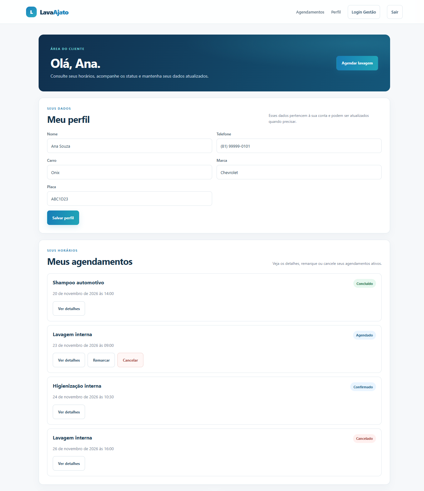
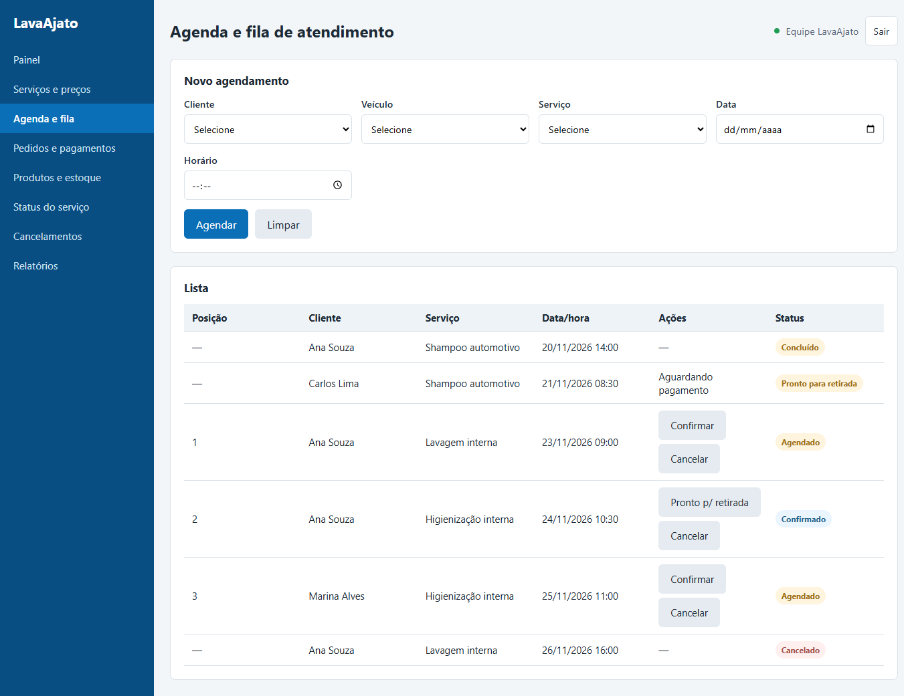
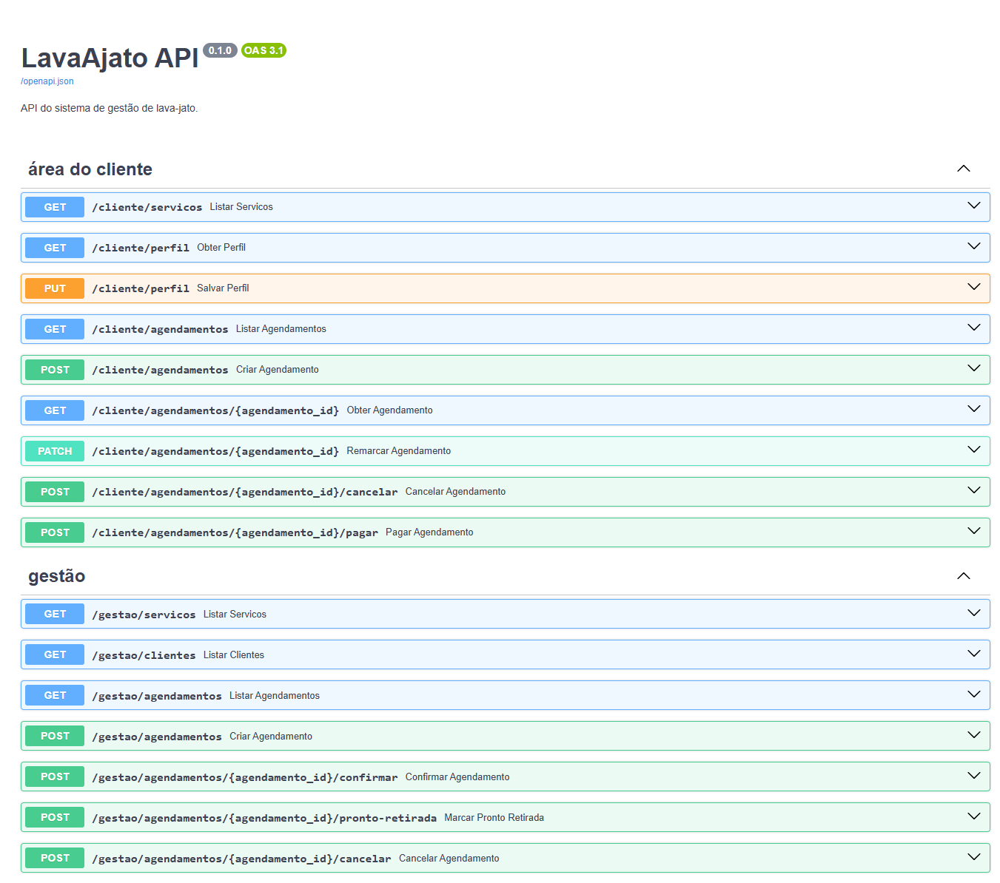
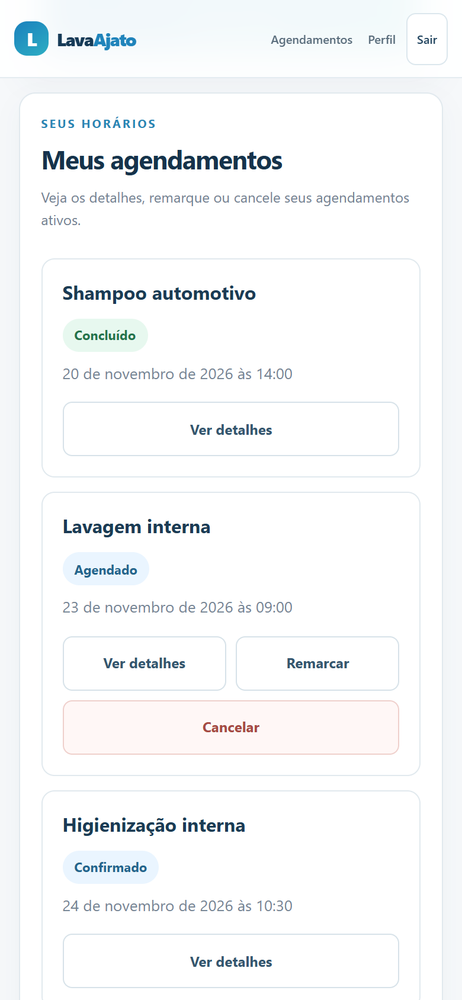

# LavaAjato

Sistema de agendamento para lava-jato: o cliente escolhe o serviço e marca o horário, e a gestão acompanha a agenda e atualiza o status de cada lavagem até a retirada do veículo.


## Demonstração online

O sistema está publicado em **https://lavaajato.onrender.com**.

| Caminho | O que é |
|---|---|
| [`/`](https://lavaajato.onrender.com/) | Área do cliente (abre a `/cliente`) |
| [`/agenda`](https://lavaajato.onrender.com/agenda) | Agenda da gestão |
| [`/docs`](https://lavaajato.onrender.com/docs) | Documentação interativa da API (Swagger) |
| [`/api`](https://lavaajato.onrender.com/api) | Índice das rotas da API, em JSON |
| [`/api/agendamentos`](https://lavaajato.onrender.com/api/agendamentos) | Lista de agendamentos, em JSON |

- **A agenda da gestão pede uma chave de acesso.** Ela é configurada no servidor e **não é pública**; quem não tem a chave consegue usar a área do cliente e a documentação da API normalmente. Antes da chave, a página pede o acesso de demonstração (`/auth`), como as demais telas da gestão.
- **A primeira visita pode levar cerca de 1 minuto.** O serviço está no plano free do Render, que "adormece" depois de um tempo sem acessos.
- **Os dados de teste são reiniciados periodicamente.** O disco do plano free é efêmero: perfis e agendamentos criados na demonstração se perdem quando o serviço reinicia.

## Telas

### Área do cliente



### Agenda da gestão



### Documentação da API



### Área do cliente no celular



## Funcionalidades

### Área do cliente (`cliente.html`)

- Cadastro e acesso de demonstração, feitos no próprio navegador.
- Perfil com nome, telefone e veículo (carro, marca e placa). É preciso salvar o perfil antes de agendar (o nome é obrigatório).
- Lista dos serviços disponíveis para agendamento.
- Agendamento com data e horário futuros, validados no fuso configurado (`TIMEZONE`). Preço e duração do serviço ficam registrados no momento do agendamento.
- Lista e detalhe dos próprios agendamentos.
- Remarcação e cancelamento, permitidos enquanto o status é `agendado`.
- Registro do pagamento quando o veículo está pronto para retirada (não há pagamento online: a ação só conclui o atendimento).

### Agenda da gestão (`agenda.html`)

- Lista de agendamentos com filtros por data e por status.
- Lista de clientes e de serviços.
- Criação de agendamento para um cliente já cadastrado.
- Confirmação, marcação de "pronto para retirada" e cancelamento.

### Fluxo de status

```
agendado  ->  confirmado  ->  pronto-retirada  ->  concluido
   |              |
   +--------------+------->  cancelado
```

| Transição | Quem faz |
|---|---|
| `agendado` -> `confirmado` | Gestão |
| `confirmado` -> `pronto-retirada` | Gestão |
| `pronto-retirada` -> `concluido` | Cliente, ao registrar o pagamento |
| `agendado` -> `cancelado` | Cliente ou gestão |
| `confirmado` -> `cancelado` | Gestão |

Qualquer outra mudança de status é recusada pela API com `409`.

## Tecnologias

- **Back-end:** Python 3.12+, [FastAPI](https://fastapi.tiangolo.com/), Pydantic / pydantic-settings (validação e configuração via `.env`), Uvicorn.
- **Banco de dados:** SQLite. Localmente, o arquivo `lavaajato.db` (módulo `sqlite3` da biblioteca padrão). Em produção, o [Turso](https://turso.tech/) (SQLite na nuvem), acessado pelo driver oficial [`turso-serverless`](https://docs.turso.tech/sdk/python/quickstart) (Python puro, via HTTP). Ver [Banco: SQLite local ou Turso](#banco-sqlite-local-ou-turso).
- **Front-end:** HTML, CSS e JavaScript nativo (módulos ES), sem framework e sem etapa de build.
- **Ferramentas:** [uv](https://docs.astral.sh/uv/) (dependências e ambiente), pytest + httpx (testes), Ruff (lint e formatação).
- **Infraestrutura:** GitHub Actions (CI) e Render (hospedagem).

## Arquitetura

Um único serviço FastAPI faz as duas coisas: atende a API (`/cliente/*`, `/gestao/*`, `/health*`, `/docs`) e serve os arquivos estáticos de `frontend/` em todos os outros caminhos. Como front e API ficam na mesma origem, não há CORS em produção. As regras de negócio ficam separadas das rotas e do acesso ao banco, e o SQLite é o único banco do projeto (em arquivo local ou no Turso).

```
LavaAJato/
├── src/
│   ├── main.py              # cria o app FastAPI, health checks e serve o frontend/
│   ├── agenda_fila/         # rotas, regras, esquemas e acesso ao banco (SQLite local ou Turso)
│   └── compartilhado/       # configuração (.env) e tratamento de erros
├── frontend/                # páginas HTML, css/ e js/ (sem build)
├── tests/                   # testes da API, health checks e frontend
├── backend/                 # código original do banco SQLite (referência)
├── lavaajato.db             # banco SQLite com as tabelas servicos, clientes e agendamentos
├── render.yaml              # Blueprint do deploy no Render
└── .github/workflows/ci.yml # pipeline de lint e testes
```

As demais pastas em `src/` (`clientes_veiculos`, `servicos_precos`, `pedidos_pagamentos` etc.) ainda não têm código: cada uma traz só um `README.md` com o planejamento do módulo.

## Rotas da API

A documentação completa, com os formatos de entrada e saída, fica em `/docs` (Swagger) e `/openapi.json`. `GET /api` devolve em JSON a lista de todas as rotas.

### API REST de agendamentos: `/api/agendamentos`

Recebe e devolve JSON. Cada agendamento sai como um dicionário simples: `id`, `cliente_id`, `nome_cliente`, `telefone_cliente`, `carro`, `marca`, `placa`, `servico_id`, `servico`, `data`, `horario`, `status`, `preco`, `duracao_min`, `criado_em`, `atualizado_em`.

| Método | Rota | Acesso | Corpo | Resposta |
|---|---|---|---|---|
| GET | `/api/agendamentos` | aberto | (filtros opcionais `?data=AAAA-MM-DD&status=`) | 200 com a lista |
| GET | `/api/agendamentos/{id}` | aberto | | 200, ou 404 |
| POST | `/api/agendamentos` | `X-Chave-Gestao` | `{cliente_id, servico_id, data, horario}` | 201 com o criado |
| PUT | `/api/agendamentos/{id}` | `X-Chave-Gestao` | `{cliente_id, servico_id, data, horario, status}` | 200 com o atualizado, ou 404 |
| DELETE | `/api/agendamentos/{id}` | `X-Chave-Gestao` | | 200 com o apagado, ou 404 |

Dados inválidos (JSON malformado, data fora de `AAAA-MM-DD`, horário fora de `HH:MM`, horário no passado, cliente ou serviço inexistente, status desconhecido) respondem **400** com `{"erro": {"codigo", "mensagem", "detalhes"}}`. Sem a chave, 401; com a chave errada, 403. Ao contrário do "cancelar" das áreas de cliente e gestão, o `DELETE` apaga a linha de verdade.

### Área do cliente: `/cliente/*`

Todas exigem o header `X-Usuario-Id` com o identificador do cliente; sem ele, `401`. A API só devolve e altera os dados desse cliente (agendamento de outro cliente responde `404`).

| Método | Rota | Descrição |
|---|---|---|
| GET | `/cliente/servicos` | Lista os serviços disponíveis para agendar |
| GET | `/cliente/perfil` | Retorna o perfil do cliente |
| PUT | `/cliente/perfil` | Cria ou atualiza o perfil do cliente |
| GET | `/cliente/agendamentos` | Lista os agendamentos do cliente |
| GET | `/cliente/agendamentos/{agendamento_id}` | Retorna um agendamento do cliente |
| POST | `/cliente/agendamentos` | Cria um agendamento (`201`) |
| PATCH | `/cliente/agendamentos/{agendamento_id}` | Remarca data e horário |
| POST | `/cliente/agendamentos/{agendamento_id}/cancelar` | Cancela um agendamento |
| POST | `/cliente/agendamentos/{agendamento_id}/pagar` | Registra o pagamento e conclui o agendamento |

### Gestão: `/gestao/*`

Todas exigem o header `X-Chave-Gestao` igual à `GESTAO_CHAVE` do servidor. Sem `GESTAO_CHAVE` configurada, `503`; sem o header, `401`; com a chave errada, `403`.

| Método | Rota | Descrição |
|---|---|---|
| GET | `/gestao/servicos` | Lista os serviços |
| GET | `/gestao/clientes` | Lista os clientes |
| GET | `/gestao/agendamentos` | Lista os agendamentos (filtros opcionais `?data=AAAA-MM-DD&status=...`) |
| POST | `/gestao/agendamentos` | Cria um agendamento para um cliente cadastrado (`201`) |
| POST | `/gestao/agendamentos/{agendamento_id}/confirmar` | Confirma um agendamento |
| POST | `/gestao/agendamentos/{agendamento_id}/pronto-retirada` | Marca o veículo como pronto para retirada |
| POST | `/gestao/agendamentos/{agendamento_id}/cancelar` | Cancela um agendamento |

### Health checks

| Método | Rota | Descrição |
|---|---|---|
| GET | `/health` | Indica que a API está no ar |
| GET | `/health/db` | Verifica se o `lavaajato.db` abre e tem as tabelas `servicos`, `clientes` e `agendamentos` (`503` se não) |

## Como rodar localmente

### Pré-requisitos

- [uv](https://docs.astral.sh/uv/getting-started/installation/) (ele baixa o Python 3.12+ se precisar).
- Git.

Não precisa de Docker nem de servidor de banco: o `lavaajato.db` já vem no repositório com as tabelas criadas.

### 1. Instalar as dependências

Na raiz do projeto (cria a `.venv`):

```cmd
uv sync
```

### 2. Criar o `.env`

```cmd
copy .env.example .env
```

Depois revise as variáveis no `.env`:

| Variável | Para que serve | Valor do exemplo |
|---|---|---|
| `SECRET_KEY` | Chave secreta da aplicação. Obrigatória: sem ela a API não sobe. Troque o valor de exemplo por uma chave gerada | `troque-por-uma-chave-aleatoria` |
| `GESTAO_CHAVE` | Chave da agenda da gestão, enviada pelo front no header `X-Chave-Gestao`. Vazia, as rotas `/gestao/*` respondem `503` | (vazia) |
| `SQLITE_PATH` | Caminho do banco SQLite. Caminho relativo é resolvido a partir da raiz do projeto. Ignorada quando o Turso está configurado | `lavaajato.db` |
| `TURSO_DATABASE_URL` | URL do banco no Turso (`libsql://...`). Com ela e o token preenchidos, a API usa o Turso no lugar do arquivo | (vazia) |
| `TURSO_AUTH_TOKEN` | Token de acesso do banco no Turso. Segredo: só no `.env` e no painel do Render | (vazia) |
| `TIMEZONE` | Fuso (nome IANA) das regras de horário dos agendamentos, independente do fuso do servidor | `America/Recife` |
| `CORS_ORIGINS` | Origens que podem chamar a API, separadas por vírgula. Só é necessária se o front for servido em outra origem; com o uvicorn, front e API ficam na mesma origem e ela pode ficar vazia | `http://localhost:5500,http://127.0.0.1:5500` |

Para gerar valores para `SECRET_KEY` e `GESTAO_CHAVE` (rode uma vez para cada):

```cmd
uv run python -c "import secrets; print(secrets.token_urlsafe(32))"
```

O `.env` não vai para o Git. Os testes não dependem dele.

### Banco: SQLite local ou Turso

A regra fica em [`src/agenda_fila/conexao.py`](src/agenda_fila/conexao.py):

- **`TURSO_DATABASE_URL` e `TURSO_AUTH_TOKEN` preenchidas:** a API usa o banco do Turso. Os dados ficam na nuvem e sobrevivem a reinícios e deploys.
- **Qualquer uma vazia ou ausente:** a API usa o arquivo de `SQLITE_PATH`, como sempre.

Nos dois modos o código é o mesmo (SQL com `?`, mesmas tabelas). Na subida, o servidor cria as tabelas (`CREATE ... IF NOT EXISTS`) e insere os 3 serviços iniciais só se a tabela `servicos` estiver vazia. Num banco que já tem dados, nada é apagado nem duplicado. Cada requisição abre e fecha a própria conexão.

Para usar o Turso localmente, copie a URL e um token do banco no painel do Turso (ou com `turso db show <banco> --url` e `turso db tokens create <banco>`) para o `.env`. Copie a URL inteira, como o Turso mostra: ela costuma incluir a região (ex.: `libsql://banco-org.aws-us-east-1.turso.io`). Se a URL estiver errada, o Turso responde `404 Host not found` e o `/health/db` dá `503`.

Limitações do modo Turso:

- **Latência:** cada comando SQL é uma requisição HTTP ao Turso, então cada chamada da API leva algumas dezenas de milissegundos a mais que no arquivo local. Crie o banco no Turso perto do Render (o serviço está na região `virginia`, leste dos EUA: use `aws-us-east-1`).
- **Sem timeout configurável:** o driver `turso-serverless` não permite definir um tempo limite nas chamadas HTTP. Se o Turso parar de responder sem fechar a conexão, a requisição fica esperando até o sistema operacional desistir. A única forma de limitar isso seria mexer no timeout global de sockets do Python ou em partes internas do driver, e o projeto não faz isso.

### 3. Subir a API e o front

```cmd
uv run uvicorn src.main:app --reload
```

Abra http://127.0.0.1:8000/. O mesmo servidor atende o front e a API:

- http://127.0.0.1:8000/: área do cliente
- http://127.0.0.1:8000/cliente: área do cliente (direto)
- http://127.0.0.1:8000/agenda: agenda da gestão (use a `GESTAO_CHAVE` do seu `.env`)
- http://127.0.0.1:8000/docs: documentação da API
- http://127.0.0.1:8000/health/db: checagem do banco

Esta é a forma oficial de rodar o projeto localmente. As páginas abrem sem o `.html` no final (`/agenda` entrega `agenda.html`), e os links antigos com `.html` redirecionam (301) para a URL limpa. Por isso, abrir o `frontend/` com outro servidor estático (Live Server, `http.server`) não funciona: os links internos dariam 404.

`/cliente` e `/gestao` são páginas do front e têm o mesmo nome dos prefixos da API (`/cliente/*`, `/gestao/*`). Não crie rotas da API exatamente em `/cliente` ou `/gestao`; os testes de `tests/test_frontend.py` quebram se isso acontecer.

## Testes e qualidade

Os testes usam um SQLite temporário com o mesmo schema do `lavaajato.db` (nunca alteram o arquivo real) e definem as próprias variáveis de ambiente, então não precisam do `.env`. Eles nunca falam com o Turso: o `tests/conftest.py` zera `TURSO_DATABASE_URL` e `TURSO_AUTH_TOKEN`, e o modo Turso é testado com um driver falso (`tests/agenda_fila/test_conexao_turso.py`). Hoje são 261 testes.

```cmd
uv run pytest
uv run ruff check .
uv run ruff format .
```

O CI ([`.github/workflows/ci.yml`](.github/workflows/ci.yml)) roda a cada Pull Request e a cada push na `develop` e na `Principal!`: instala as dependências com `uv sync --locked` (falha se o `uv.lock` estiver desatualizado), roda `ruff check .`, `ruff format --check .` e `pytest`.

## Deploy (Render)

### Como está montado

Um único **web service** Python no Render (plano free) roda o FastAPI, que serve **a API e o front no mesmo domínio**:

- `/api`, `/api/agendamentos/*`, `/cliente/*`, `/gestao/*`, `/health`, `/health/db`, `/docs`, `/openapi.json`: API
- banco: o Turso (`TURSO_DATABASE_URL` e `TURSO_AUTH_TOKEN`), para os dados não sumirem; na subida, o servidor cria as tabelas e os serviços iniciais se ainda não existirem, e num banco existente nada é alterado
- qualquer outro caminho: arquivos de `frontend/` com URL limpa (`/agenda` entrega `agenda.html`, `/agenda.html` redireciona com 301 para `/agenda` e `/` abre o `index.html`, que redireciona para `/cliente`)

O front chama a API pela mesma origem da página, então não há CORS envolvido e `CORS_ORIGINS` não precisa ser configurada no Render.

A configuração fica no [`render.yaml`](render.yaml) (Blueprint), na raiz:

- build: `uv sync --locked --no-dev` (o Render instala o uv sozinho porque há um `uv.lock` na raiz)
- start: `uv run --no-sync uvicorn src.main:app --host 0.0.0.0 --port $PORT`
- health check: `/health/db`
- Python `3.12.16` (variável `PYTHON_VERSION`), região `virginia`, deploy da branch `Principal!`

### Criar o serviço pelo Blueprint

1. No painel do Render: **New → Blueprint** e escolha este repositório (branch `Principal!`).
2. O Render lê o `render.yaml` e pede os valores marcados com `sync: false`:
   - **`GESTAO_CHAVE`**: chave da agenda da gestão. Gere uma com o comando da seção [Criar o `.env`](#2-criar-o-env). Sem ela, as rotas `/gestao/*` respondem `503`.
   - **`TURSO_DATABASE_URL`** e **`TURSO_AUTH_TOKEN`**: URL e token do banco no Turso (ver [Banco: SQLite local ou Turso](#banco-sqlite-local-ou-turso)). Sem elas, o serviço usa o arquivo SQLite no disco efêmero.
3. Confirme. A `SECRET_KEY` é gerada automaticamente pelo Render; `SQLITE_PATH`, `TIMEZONE` e `PYTHON_VERSION` já vêm do arquivo.

O Render só pede os valores `sync: false` na **criação** do Blueprint. **No serviço que já existe**, adicione `TURSO_DATABASE_URL` e `TURSO_AUTH_TOKEN` em **Environment** no painel do serviço (o mesmo vale para trocar a `GESTAO_CHAVE`). A cada push na `Principal!`, o Render faz um novo deploy.

### Avisos do plano free

- **O disco é efêmero.** Tudo que for gravado em arquivo no Render se perde quando o serviço reinicia, dorme ou recebe deploy. Por isso o banco de produção fica no Turso. Sem `TURSO_DATABASE_URL` e `TURSO_AUTH_TOKEN` no painel, o serviço volta a usar o `lavaajato.db` do disco, e os perfis e agendamentos somem a cada reinício.
- **A primeira visita pode demorar cerca de 1 minuto.** Depois de 15 minutos sem acessos o Render "adormece" o serviço; a próxima requisição o acorda.

## Como o Git funciona aqui

Usamos Git Flow com três níveis:

```
feature/*  ->  develop  ->  Principal!
```

- **`Principal!`** é a branch de produção: tem as versões fechadas e é dela que o Render faz o deploy. Ninguém commita direto nela.
- **`develop`** junta o trabalho pronto da equipe. Também não recebe commit direto.
- Cada tarefa nasce de uma branch criada a partir da `develop` (`feature/`, `fix/`, `docs/`, `ci/`...):

  ```cmd
  git checkout develop
  git pull
  git checkout -b feature/nome-da-tarefa
  ```

- Ao terminar, abra um Pull Request da sua branch para a `develop`. O CI precisa passar antes do merge.
- Quando uma versão fecha, a `develop` vai para a `Principal!` por Pull Request, e isso dispara um novo deploy.
- Commits no padrão [Conventional Commits](https://www.conventionalcommits.org/pt-br/v1.0.0/), em português: `tipo(modulo): descrição` (ex.: `feat(agenda): bloquear horário em conflito`).
- Mais detalhes em [CONTRIBUTING.md](CONTRIBUTING.md).

## Limitações conhecidas e próximos passos

- **Autenticação de demonstração.** Não há login real no servidor: o cadastro e o acesso ficam no navegador, e a API identifica o cliente só pelo header `X-Usuario-Id`, sem verificação (quem enviar o id de outro cliente age como ele). A gestão usa uma chave compartilhada (`GESTAO_CHAVE`) em vez de usuários. Próximo passo: login no servidor com token assinado e perfis de acesso.
- **`servicos.html` ainda usa o `localStorage`.** O cadastro de serviços da gestão não está ligado à API; a área do cliente e a agenda leem os serviços do banco.
- **Painel (`gestao.html`) e `pedidos.html` estão no fluxo antigo.** Ainda trabalham com dados do `localStorage`, não com os agendamentos da API. As outras telas da gestão (clientes, produtos, status, cancelamentos, avaliações, relatórios) são protótipos visuais.
- **O veículo vem do perfil atual.** O agendamento não guarda uma cópia do veículo: se o cliente muda carro ou placa no perfil, os agendamentos antigos passam a mostrar os dados novos.
- **Turso sem timeout e com latência de rede.** O driver não tem tempo limite configurável e cada comando SQL é uma requisição HTTP (ver [Banco: SQLite local ou Turso](#banco-sqlite-local-ou-turso)).
- **Módulos planejados sem código.** Pedidos e pagamentos, estoque, avaliações e relatórios ainda estão só no planejamento (`src/*/README.md`). Escopo completo em [docs/escopo.pdf](docs/escopo.pdf), com [requisitos](docs/requisitos.md) e [regras de negócio](docs/regras-de-negocio.md).

## Equipe

| Integrante | Papel | GitHub |
|---|---|---|
| Kaiky Jefferson | Back-end, integração, CI e deploy | [github.com/kaikyjefferson0](https://github.com/kaikyjefferson0) |
| Nicolas Gabriel | Banco de dados, back-end e front-end | [github.com/NickkDEV084](https://github.com/NickkDEV084) |
| David Dias | Design e front-end | - |
| Leonardo Novaes | Back-end | - |
| Vanderson Lucas | Back-end | - |
